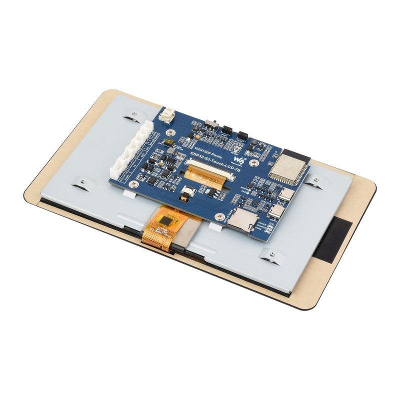
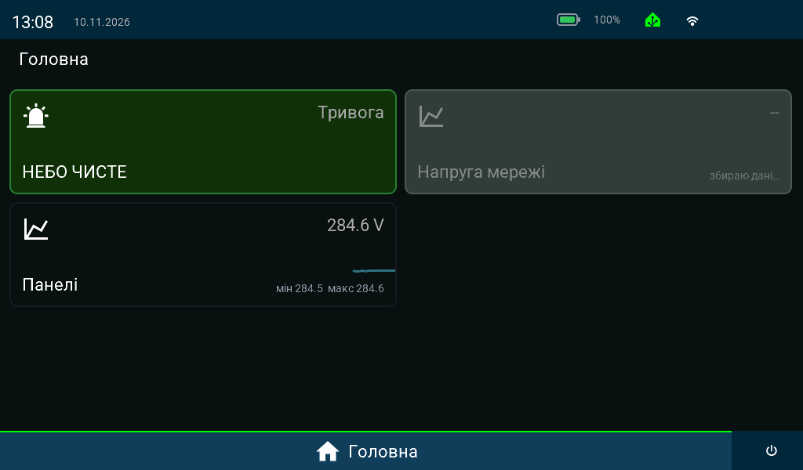
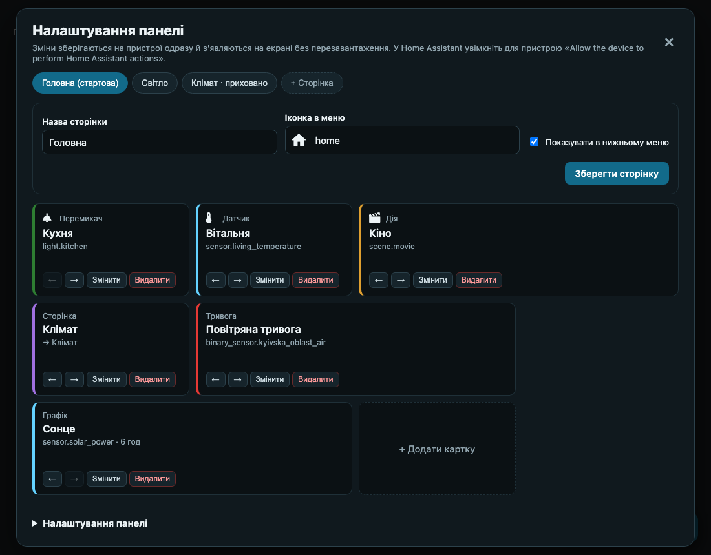
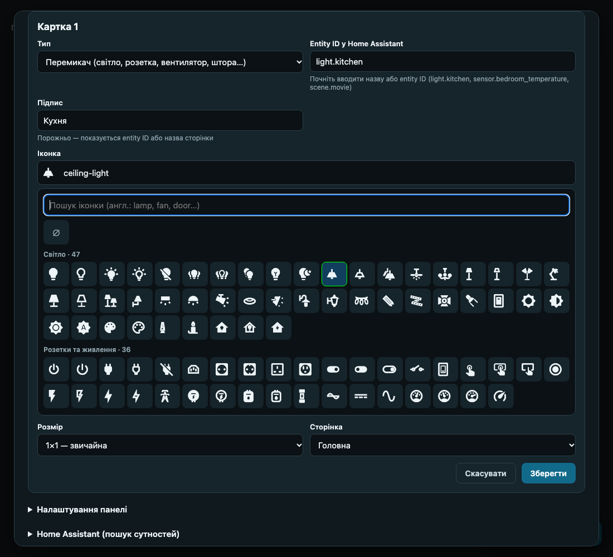
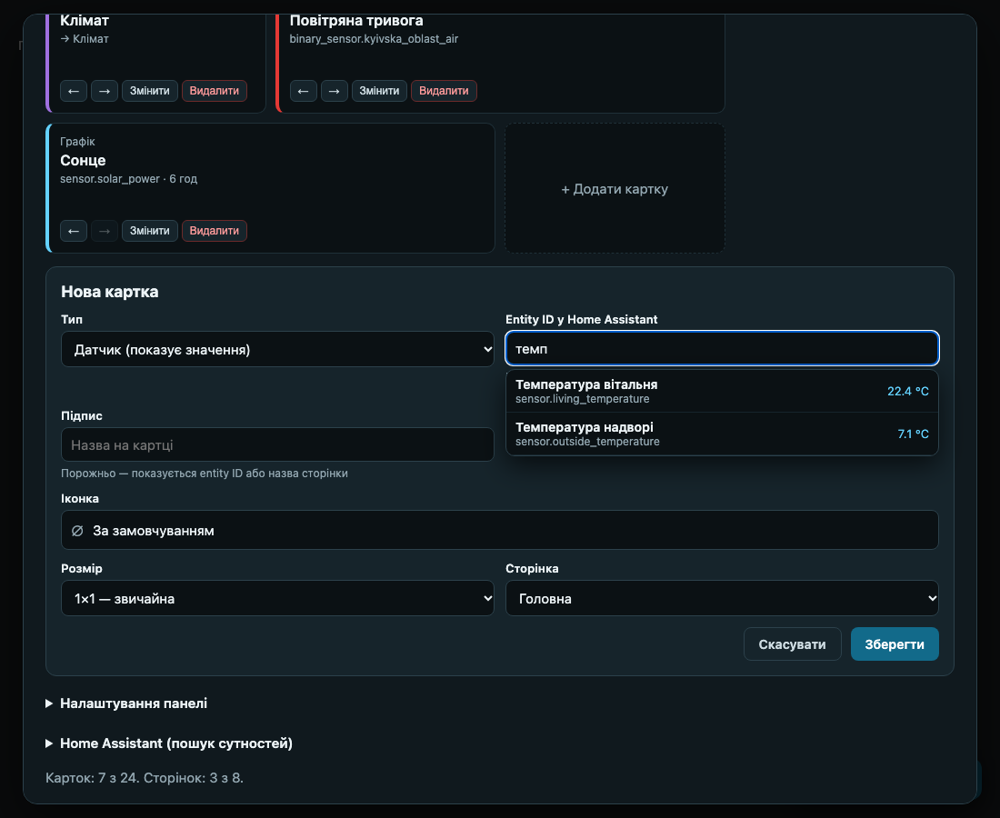
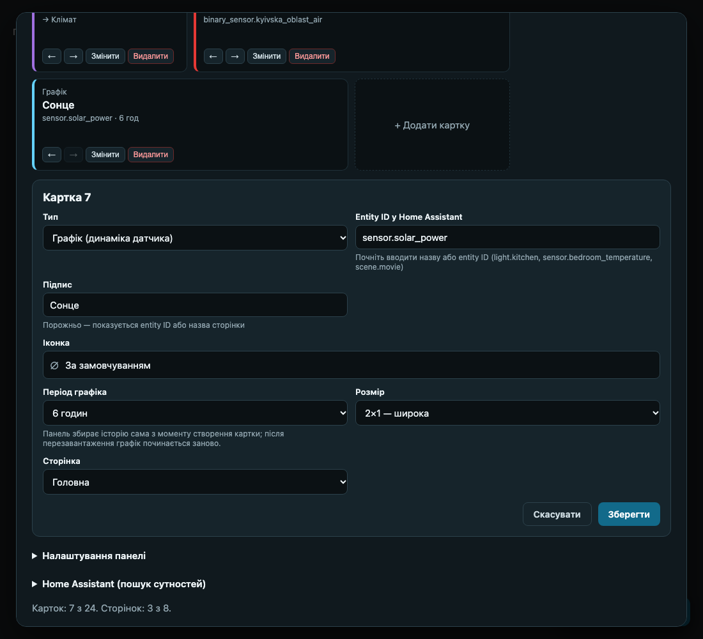
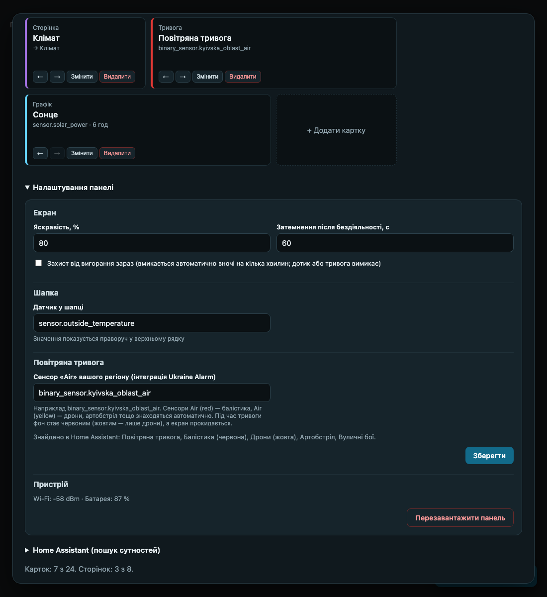

# Smart Home Control Panel (ESP32-S3-Touch-LCD-7)

An intelligent smart home control panel based on **ESPHome** and **LVGL**. This project is optimized for the 7-inch high-definition touchscreen, providing a smooth user interface and deep integration with Home Assistant.



## 📸 Screenshots

**Panel screen** — taken from the device itself (`http://<panel-ip>/screenshot.bmp`): air-alarm card, chart cards drawn behind their values, status bar with the battery indicator.



**Web editor** — opened from the panel's IP address (shown here with demo data from `tools/configurator_preview.html`).

| | |
|---|---|
|  Pages and cards |  Icon picker (520 icons, search) |
|  Home Assistant entity search |  Chart card with period |
|  Panel settings: screen, status bar, air alarm, device | |

To refresh the editor screenshots: open `tools/configurator_preview.html#icons` (also `#search`, `#chart`, `#settings`) in a browser. To grab the panel screen: `curl -o screen.bmp http://<panel-ip>/screenshot.bmp`.

## 🛠 Technical Specifications

*   **Controller**: ESP32-S3 (Dual-core, 240MHz).
*   **Memory**: 16MB Flash, 8MB Octal PSRAM.
*   **Display**: 7" IPS, 1024x600 resolution, RGB (DPI) interface.
*   **Touch Sensor**: GT911 (Capacitive, I2C).
*   **Peripherals**: Built-in **CH32V003** port expander (manages display reset, touchscreen reset, and backlight brightness).
*   **Power**: Li-ion battery support with voltage monitoring via the expander's built-in ADC.

## 📡 Home Assistant

Nothing about your home is hard-coded in the firmware. Pages, the bottom menu and every card are configured from the panel's web page (espcontrol-style), and the panel talks to Home Assistant directly over the native ESPHome API.

## 📌 Pinout

### Display (RGB DPI)
| Signal | ESP32-S3 Pins |
| :--- | :--- |
| **Red** | GPIO1, 2, 42, 41, 40 |
| **Green** | GPIO39, 0, 45, 48, 47, 21 |
| **Blue** | GPIO14, 38, 18, 17, 10 |
| **Sync/Clock** | HSYNC: 46, VSYNC: 3, PCLK: 7, DE: 5 |

### Touch Sensor & I2C Bus
*   **SDA**: GPIO08
*   **SCL**: GPIO09
*   **INT (Touch)**: GPIO4 (Used to fix the I2C address to 0x5D).
*   **Reset (Touch)**: Pin 1 on the CH32V003 expander.

### CH32V003 Port Expander (I2C)
*   **Pin 1**: Touchscreen Reset.
*   **Pin 3**: Display Reset.
*   **PWM**: Backlight brightness control (inverted).
*   **ADC**: Battery voltage monitoring.

## 🏗 Project Architecture

*   `panel-s3.yaml` — hardware (display, touch, CH32V003 expander, backlight, battery, antiburn).
*   `simulator.yaml` — the same UI on a PC via SDL.
*   `base_logic.yaml` — fonts and icons.
*   `gui.yaml` — LVGL styles; the only page is `page_runtime`, plus the boot screen overlay.
*   `config/panel/top_layer.yaml` — status bar, generated bottom menu, boot screen.
*   `config/panel/system.yaml` — brightness, sleep timeout, clock and status icons (shared).
*   `config/panel/runtime_cards.yaml` — text entities that store pages and cards (shared).
*   `config/panel/panel_cards.h` — renders pages/cards/menu, subscribes to HA, calls HA actions.
*   `config/panel/configurator.js` / `.css` — the web editor.

## 💡 Implementation Details (Knowledge Base)

### Pages and cards from the web page

Open the panel's IP address in a browser — the page is the panel editor:

* **Pages** — up to 8. Each has a title, an icon and a "show in bottom menu" switch; hidden pages are reached through "go to page" cards. The first page is the start page. Pages can be reordered and deleted (their cards go with them).
* **Cards** — up to 24 in total, on any page. Types:
  * **Перемикач** — toggles `light.*`, `switch.*`, `fan.*`, `input_boolean.*`, `cover.*`, `lock.*`; highlighted when on.
  * **Датчик** — shows the state with its unit.
  * **Дія** — runs a `scene`, `script`, `automation`, `button` or `input_button`.
  * **Перехід на сторінку** — opens another page; the back button returns.
  * **Повітряна тривога** — Ukraine Alarm status: green «НЕБО ЧИСТЕ», yellow for drones only (Air (yellow)), red for ballistics (Air (red)), a general air alarm or other threats; lists the active threats.
* **Sizes** — 1×1, 2×1, 2×2 or full width. The grid adapts to the screen: 4 columns on wide displays (3 or 2 on narrower ones), 3 rows visible, scrolls if there are more.
* **Налаштування панелі** — brightness, sleep timeout, anti-burn-in now, status-bar sensor, air-alarm sensor, Wi‑Fi / battery info, restart.

### Air alarm

Set the region's Ukraine Alarm **Air** sensor (`binary_sensor.<region>_air`) in *Налаштування панелі → Повітряна тривога*. The other sensors of the region (`_air_red`, `_air_yellow`, `_artillery`, `_urban_fights`, `_chemical`, `_nuclear`, `_unknown`) are derived from it. While any of them is on, the page background turns red (dark yellow if only drones), the screen wakes up and the anti-burn-in snow stops. To test, set e.g. `binary_sensor.<region>_air_yellow` to `on` in HA *Developer tools → States*.

The timezone is not a panel setting: Home Assistant 2026.3+ sends its own timezone to the device; the YAML value is the fallback.

Changes are stored on the device and show up on screen immediately, no reboot.

Storage (all `text` entities, category *config*, hidden in HA by default):
* `Panel Pages` — `title|icon|nav;title|icon|nav;…`
* `Panel Card N` — `type;entity;label;icon;page;size`
* `Panel Header Sensor` — entity id
* `Panel Alarm Sensor` — entity id of the region's Ukraine Alarm "Air" sensor

**Required once in Home Assistant:** *Settings → Devices & services → ESPHome → (this panel) → Configure →* enable **Allow the device to perform Home Assistant actions**. Without it toggles and actions are ignored.

Entity fields in the web editor search Home Assistant entities by name or entity ID, filtered by card type. Open "Home Assistant (пошук сутностей)" in the editor and enter the HA address and a long-lived access token (HA → Profile → Security). The browser fetches the entity list straight from the HA WebSocket API; the token stays in that browser's localStorage and is never stored on the panel. `tools/configurator_preview.html` opens the editor offline with a fake device and fake HA.

Icons are picked visually in the web editor (grouped grid with search). The set of icons available on the panel is listed in `config/panel/icons.txt` (MDI names, `## Group` lines start a picker group). After editing it run:

```
pip install fonttools
python3 tools/gen_icons.py
```

It regenerates `config/panel/icon_glyphs.yaml` (glyphs of the `mdi_36` font), `config/panel/panel_icons.h` (name → glyph table for the firmware), the icon list in `configurator.js` and the preview font embedded in `configurator.css`. Each icon costs ~0.5 KB of flash. `font_viewer.html` can still be used to browse every glyph in the font files.

The web server uses plain local HTTP without auth. Keep the panel on a trusted LAN.

The simulator has no web server (not supported on the host platform); set its text entities through Home Assistant.

### 1. Touchscreen I2C address and start-up (GT911)
The GT911 selects its I2C address (0x5D with INT low) when released from reset. The reset sequence, address selection and retries are handled by the local driver copy in `components/gt911` — see [Touchscreen (GT911) start-up](#touchscreen-gt911-start-up).

### 2. Brightness and sleep
`Screen Brightness` and `Screen Sleep Timeout` number entities (web page / HA) replace the old settings page. After the timeout the backlight dims to 3%; the touch that wakes the screen is swallowed so it does not press a card. The power button at the right of the bottom menu dims the screen immediately.

## 🚀 Build and Flash

`panel-s3.yaml` is the **public firmware**: it contains no secrets (no Wi-Fi password, no API key, no OTA password), so GitHub Actions can build it and publish it in releases.

| What | Where it lives |
|---|---|
| Wi-Fi network | on the device — set via the fallback AP **Controll Panel Fallback** (captive portal) or Improv over USB ([web.esphome.io](https://web.esphome.io)) |
| API encryption key | on the device — provisioned by Home Assistant when the panel is added |
| LAN OTA password | = the API key (base64, as shown in HA), applied at runtime |
| Firmware version | the git tag (`-s firmware_version v1.2.0`), `dev` for local builds |

Wi-Fi and the API key can only be provisioned during the first **15 minutes after power-up** (`provisioning:`); to change them later, power-cycle the panel.

**Builds from your computer** use `panel-local.yaml` (git-ignored; copy `panel-local.example.yaml`). It adds what the CLI needs: the API key from `secrets.yaml` (`api_key`) for logs and uploads, and the upload address.
```bash
esphome run panel-local.yaml --device OTA   # build + upload over Wi-Fi
esphome logs panel-local.yaml           # logs
esphome run simulator.yaml              # simulator (needs SDL2)
```

**A new panel:** flash `panel-s3.factory.bin` from a release (USB, [web.esphome.io](https://web.esphome.io)), connect to the **Controll Panel Fallback** Wi-Fi and enter your network (or use Improv in web.esphome.io), then add the device in Home Assistant — HA generates and provisions the API key. Enable *Allow the device to perform Home Assistant actions*.

### Releases and updates over the internet

* **CI** (`.github/workflows/ci.yml`, every push to `main` and every PR): checks that the icon files are generated from `icons.txt`, that the web editor parses, validates `simulator.yaml` and builds `panel-s3.yaml`.
* **Release** (`.github/workflows/release.yml`): push a tag
  ```bash
  git tag v1.2.0 && git push origin v1.2.0
  ```
  GitHub builds the firmware with that version and publishes a release with `panel-s3.ota.bin`, `panel-s3.factory.bin` and `panel-s3.manifest.json`. Tags with a dash (`v1.3.0-rc1`) become pre-releases and are not offered to the panel.
* **The panel** checks `releases/latest/download/panel-s3.manifest.json` every 6 hours (HTTPS, certificate verified). A newer version shows up in Home Assistant as the **Firmware** update entity with an *Install* button; the panel downloads the image from GitHub, checks its MD5 and reboots. Settings, Wi-Fi and the API key are kept.
* Local builds report version `dev-local`, so HA will offer the latest release on top of them — that is expected.

### Web page and security

* The device web page is only the panel editor (`web_server: js_url: ""`): the stock ESPHome UI (entity list, logs, firmware upload through the browser) is not loaded. The REST API the editor uses stays available.
* Firmware upload through the web page is disabled (`web_server: ota: false`); LAN uploads need the API key as password; internet updates come only from this repository's releases.
* The previous API key was committed to this public repository; it has been replaced. Never put keys or passwords into `panel-s3.yaml` — use `secrets.yaml` / `panel-local.yaml` (both git-ignored).

### Touchscreen (GT911) start-up

On this board the GT911 RESET line goes through the CH32V003 I2C IO expander and the first I2C transfer to the controller occasionally fails. The stock ESPHome driver makes a single attempt and then marks the touchscreen FAILED for good (no touch until the next reboot). `components/gt911` is a local copy of the ESPHome 2026.9 driver (enabled in `external_components` of `panel-s3.yaml`) that:

* uses the datasheet reset timing (RESET low 10 ms → RESET high → hold INT 10 ms → release INT → wait 60 ms → first I2C transfer);
* keeps the configured address 0x5D instead of permanently switching to 0x14 after a failed probe;
* retries reset + probe up to 5 times.

The result is printed in the config dump (`esphome logs` → `GT911 Touchscreen: … Setup: OK after N attempt(s)`). When upgrading ESPHome, compare the copy with the new upstream driver.
